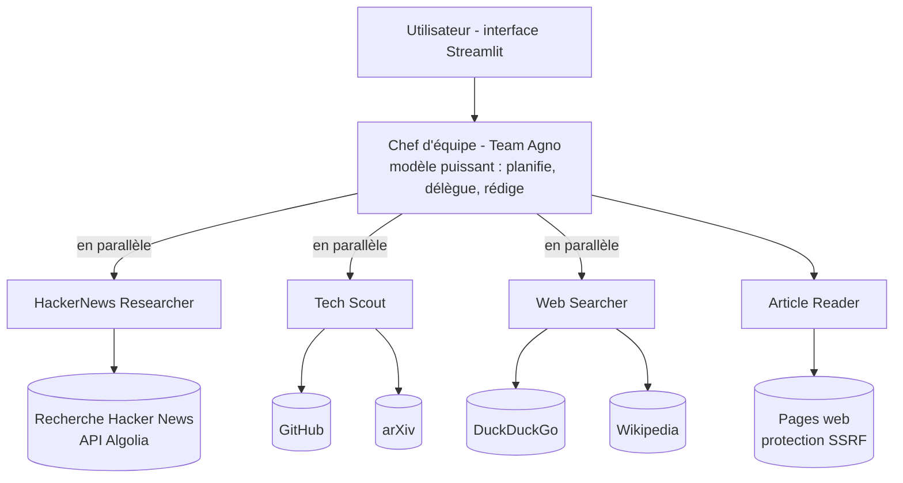

# 🔍 Multi-Agent AI Researcher (version améliorée)

Une équipe de **4 agents IA** coordonnée par un chef d'équipe analyse **Hacker News, GitHub, arXiv et le web**, puis rédige un **rapport de tendances sourcé** sur le sujet de votre choix.

> **Projet de départ :** [multi_agent_researcher](https://github.com/Shubhamsaboo/awesome-llm-apps/tree/main/advanced_ai_agents/multi_agent_apps/multi_agent_researcher) du dépôt *awesome-llm-apps*.
> Le code d'origine est conservé tel quel dans [`original/`](original/). Dans [`research_agent.py`](research_agent.py), chaque modification est marquée `[AMELIORATION n]` avec un commentaire qui explique ce que faisait l'original et ce qui a changé.

---

## 🧠 Architecture



- **Framework :** [Agno](https://github.com/agno-agi/agno) (`Agent`, `Team` en mode *coordinate*)
- **LLM :** Gemini, OpenRouter, OpenAI ou Ollama (local), au choix
- **Interface :** Streamlit, avec affichage en direct du travail des agents

---

## ✨ Améliorations par rapport au projet original

### 🐛 Corrections de bugs

| Problème dans l'original | Correction |
|---|---|
| `requirements.txt` incomplet (`ddgs`, `newspaper4k`, `lxml_html_clean` manquants) : l'application plantait au démarrage | Dépendances ajoutées |
| `research_agent_llama3.py` plantait : `max_tokens` n'existe plus dans Agno | Remplacé par `options={"num_predict": 1024}` |

### 🔌 Fournisseurs et modèles

| Original | Version améliorée |
|---|---|
| OpenAI uniquement | **4 fournisseurs** : Gemini, OpenRouter, OpenAI, Ollama |
| Nom de modèle écrit en dur | **Détection automatique** des modèles disponibles avec la clé de l'utilisateur (Gemini : dernière génération, « lite » d'abord ; OpenRouter : modèles gratuits compatibles avec les outils, éditeurs reconnus d'abord) |
| `gpt-4o-mini` pour tous | **Routage par rôle** : modèle puissant pour le chef d'équipe, modèle rapide et économique pour les agents, qui font la majorité des appels |
| Aucune solution de secours | **Fallback automatique** vers d'autres modèles en cas de surcharge (503) ou de limite (429), puis vers Ollama en local en dernier recours |

### 🧰 Outils et agents

| Original | Version améliorée |
|---|---|
| `HackerNewsTools` : uniquement les *top stories* du moment, réponses très volumineuses | **Recherche par mot-clé dans toute l'archive** (API Algolia) et résultats compacts (titre, lien, points, commentaires, date) |
| `DuckDuckGoTools` seul | **Wikipedia en secours** quand DuckDuckGo bloque les requêtes automatiques |
| `Newspaper4kTools` sans limite | **Lecteur d'articles sécurisé** : anti-SSRF, vérification de chaque redirection, 2 Mo maximum téléchargés, 4 000 caractères maximum renvoyés |
| 3 agents | **4ᵉ agent « Tech Scout »** : projets GitHub populaires et articles de recherche arXiv récents |
| Aucun cache | **Cache d'une heure** sur les outils et sur les rapports complets |

### 🧭 Coordination

- Recherches **en parallèle** au premier tour au lieu de l'une après l'autre
- **Interdiction de déléguer deux fois la même tâche**
- Rapport structuré (titre, tendances avec preuves, projets et articles, sources) dans **la langue de la question**

### 🔒 Sécurité et maîtrise des coûts

| Risque | Protection |
|---|---|
| Fuite de clé : l'original écrivait la clé dans `os.environ`, partagé entre utilisateurs | Clé lue depuis `.env` (jamais affichée) et **passée directement au modèle** ; `.env` exclu de Git |
| Injection de prompt via une page web | Chaque agent traite le contenu web comme **une donnée, jamais une instruction** |
| SSRF : un agent amené à lire `localhost`, le réseau interne ou `169.254.169.254` | Adresses privées refusées, **y compris après redirection** (9 attaques testées, toutes bloquées) |
| Agent qui boucle et fait exploser la facture | **Nombre maximum d'appels d'outils** : 4 par agent, 8 pour le chef d'équipe |
| Abus de l'application | Question validée (non vide, 500 caractères maximum) et **5 recherches par 10 minutes** par utilisateur |

### ⚡ Rapidité et expérience utilisateur

| Original | Version améliorée |
|---|---|
| `stream=False` : page vide jusqu'à la fin | **Progression en direct** de chaque délégation et de chaque outil, avec exécution asynchrone (agents en parallèle) |
| La recherche se relançait à chaque changement de réglage | Formulaire avec bouton **« Lancer la recherche »** |
| Chaque question recalculée | **Cache des rapports** : une même question dans l'heure répond instantanément, sans appel au LLM |
| `st.write(response.content)` | **Indicateurs** (durée, tokens, étapes, modèles), **export Markdown**, **journal des agents**, **messages d'erreur compréhensibles** |

---

## 🧪 Problèmes réels rencontrés et solutions

Chaque amélioration répond à un problème observé pendant les tests :

| Problème observé | Solution |
|---|---|
| Plus de crédit sur le compte OpenAI | Support de Gemini et OpenRouter (offres gratuites) |
| Gemini : erreur 503 « high demand » | Fallback automatique et modèles « lite » en priorité |
| Gemini : erreur 404 sur d'anciens modèles encore listés par l'API | Filtrage par génération et exclusion automatique des modèles refusés |
| OpenRouter : limite quotidienne des modèles gratuits (429) | Fallback, message d'erreur clair et pas de nouvel essai inutile (chaque essai consomme le quota) |
| Agent qui télécharge 150 articles (16 800 tokens pour un seul appel) | Recherche Hacker News par mot-clé et résultats compacts |
| DuckDuckGo : « No results found » et délais dépassés | Wikipedia en secours |
| Page vide pendant plusieurs minutes | Streaming et progression en direct |
| Ollama sur CPU sans GPU : environ 1 token/s, inutilisable pour 4 agents | Ollama conservé uniquement comme secours local optionnel |

---

## 🚀 Installation

```bash
python -m venv venv
venv\Scripts\activate          # Windows (Linux/Mac : source venv/bin/activate)
pip install -r requirements.txt
```

**Configuration :** copiez `.env.example` en `.env` et renseignez au moins une clé (`GOOGLE_API_KEY`, `OPENROUTER_API_KEY` ou `OPENAI_API_KEY`). Sans `.env`, l'interface demande la clé.

**Lancement :**

```bash
streamlit run research_agent.py
```

---

## 📁 Structure

| Fichier | Rôle |
|---|---|
| `research_agent.py` | Application principale : le fichier original amélioré, sections marquées `[AMELIORATION n]` |
| `research_agent_llama3.py` | Version Ollama du projet d'origine, bug corrigé. Fichier indépendant, non utilisé par `research_agent.py` (Ollama est intégré directement dans l'application) |
| `researcher/providers.py` | Fournisseurs, détection des modèles, routage par rôle, messages d'erreur |
| `researcher/tools.py` | Outils : Hacker News, GitHub, arXiv, web, Wikipedia, lecture d'articles |
| `researcher/security.py` | Validation des entrées, anti-SSRF, limite d'usage, lecture des secrets |
| `original/` | Code d'origine non modifié, pour comparaison |
| `examples/` | Exemple réel de rapport généré par l'application (sortie brute du modèle, non relue) |

---

## ⚠️ Limites connues

- DuckDuckGo peut bloquer les requêtes automatiques ; Wikipedia prend alors le relais.
- Les modèles gratuits (Gemini, OpenRouter) ont des limites d'usage et peuvent être saturés aux heures de pointe.
- Les LLM s'appuient en partie sur leurs connaissances d'entraînement : malgré la date fournie dans le contexte, ils peuvent orienter leurs recherches vers des années passées.
- Ollama est très lent sans GPU.
- L'Article Reader n'extrait que le texte : les graphiques et images des articles sont ignorés.

---

## 🔭 Pistes d'amélioration

- **Lecture des graphiques** : envoyer les images principales d'un article à un modèle multimodal (ex. Gemini), en limitant leur nombre pour maîtriser le coût en tokens.
- **Évaluation comparative des modèles** : un jeu de questions fixe pour comparer durée, tokens, nombre de sources et qualité selon le modèle.
- **Export PDF** des rapports.
- **Déploiement en ligne** (ex. Streamlit Community Cloud) avec les clés stockées dans les secrets du serveur.

---

## 🛠️ Méthode de travail

Analyse du projet original, tests en conditions réelles avec plusieurs fournisseurs, identification des problèmes à partir des journaux d'exécution, puis améliorations ciblées. Développement assisté par IA ; chaque modification a été testée et peut être expliquée.

## 🙏 Crédits

Projet original : [awesome-llm-apps](https://github.com/Shubhamsaboo/awesome-llm-apps) par Shubham Saboo. Le README d'origine est disponible dans [`original/README.md`](original/README.md).
